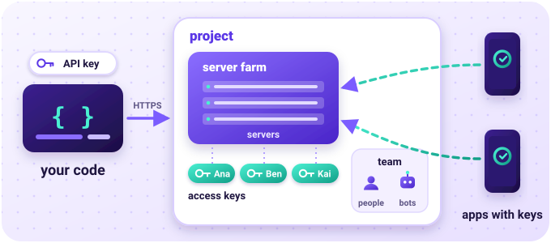

# Call the VpnHood! MANAGER API

VpnHood! MANAGER runs your VPN servers and gives out the access keys people connect with. Its panel is built on a REST
API at `https://api.vpnhood.com`, and your code can call the same API: give each customer an access key from your
billing system, add servers from a script, or read usage into your own reports.

## What a project holds

Everything belongs to a project, the one whose id is in your panel's address. A **server farm** groups the servers
that apps reach as one. An **access key** belongs to a farm: an app that has it connects to the farm's servers, within
the limits of the key's **access key profile**. The project's **team** holds the people and the bots that work on it,
each with a role.

## Get an API key

1. **Add a bot.** In the panel, open **Settings**, select **Team**, then **Add Bot**, and name the bot. The panel shows
   its API key once, as the value of an `Authorization` header: copy it. Keep it as a secret, as anyone who has it acts
   as the bot; if it leaks, reset it on the bot's page.
2. **Give it a role.** The bot joins as `ProjectReader`, which only reads. Open its page and give it the role its work
   needs: `AccessTokenWriter` gives out access keys, and `ProjectWriter` adds and installs servers too.
3. **Call the API.** Send the key in the `Authorization` header of every request. Each operation in the
   [reference](reference.md) says which permission it needs, and which roles have it.

The examples below keep the key, as the panel shows it, in `VH_API_KEY`, and your project's id in `PROJECT_ID`.

## Give a customer an access key

These are the requests a billing system makes once a server runs in your farm, as
[Add a server](https://www.vpnhood.com/vpnhood-manager/docs/add-server/) shows in the panel: it finds the farm and the
profile once, then makes a key for each customer and sends it to them.

### Find your server farm

A new project has one farm, and every key belongs to a farm.

<!-- example: list-server-farms -->

Keep its `serverFarmId` as `FARM_ID`.

### Choose an access key profile

A profile sets the limits of the keys made from it: how many devices, how much traffic, and for how long. A new
project has two: a public one, for a free key that anyone may share, and a private one, for a premium key that one
customer uses on a few devices.

<!-- example: list-access-key-profiles -->

Keep the private profile's `accessTokenProfileId` as `PROFILE_ID`.

### Create the key

`accessTokenName` is the name the panel shows, and `customerId`, with `orderId` and `shopId`, keeps your billing
system's ids with the key, so you can find it again.

<!-- example: create-access-key -->

The answer is a list, as one request can make many keys with `count`. Keep the key's `accessTokenId` as `KEY_ID`.

### Send the customer their key

<!-- example: get-access-key -->

That is the access key itself: the text the customer pastes into a VpnHood app, or into your own app built on
VpnHood.

### Read its usage

`usageBeginTime` starts the period it counts, in UTC; here it is `SINCE`. The free plan's report goes back 33 days at
most.

<!-- example: get-access-key-usage -->

### Stop it

When the customer stops paying, disable the key: the app can no longer connect with it, and tells the customer to
contact your support. An update sends only the fields it changes, each as `{ "value": ... }`.

<!-- example: disable-access-key -->

## Go further

- The [reference](reference.md) has every operation, its parameters and fields, and the permission it needs.
- [openapi.json](openapi.json) is the API's description in OpenAPI 3.1: give it to a code generator for a client in
  your language, or to an AI agent that calls the API for you.
- The panel's [roles](https://www.vpnhood.com/vpnhood-manager/docs/roles/) page says what each role may do.
